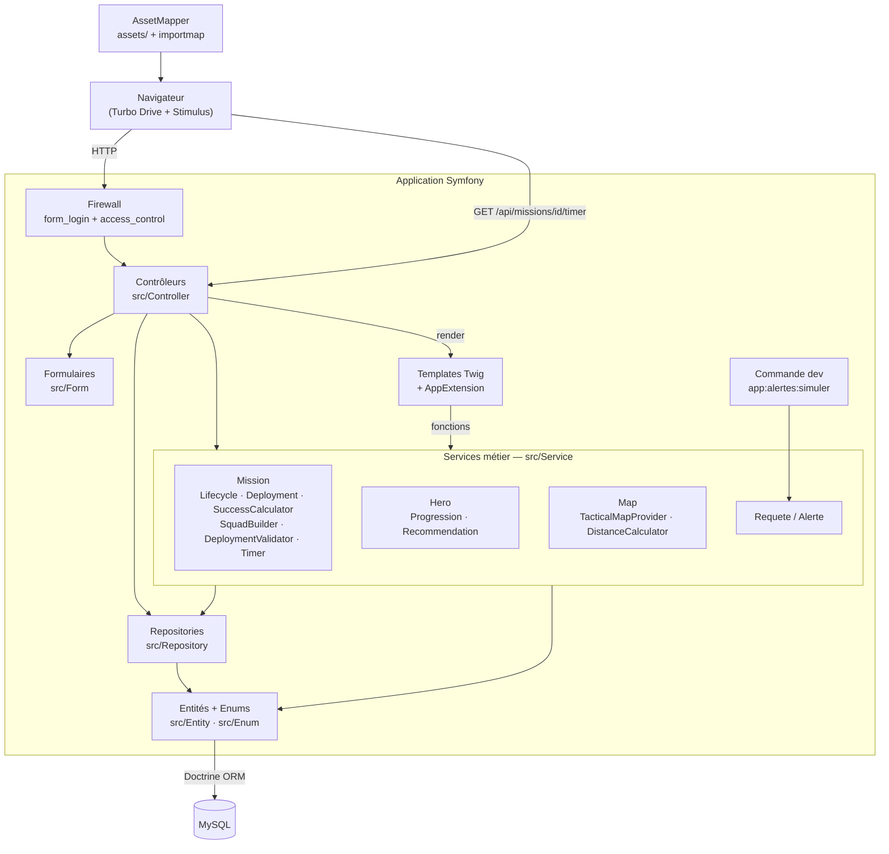

# Architecture

## Sommaire

1. [Vue d'ensemble](#vue-densemble)
2. [Arborescence](#arborescence)
3. [Contrôleurs](#contrôleurs)
4. [Services métier](#services-métier)
5. [Formulaires](#formulaires)
6. [Repositories](#repositories)
7. [Templates Twig](#templates-twig)
8. [Assets](#assets)
9. [Séparation des responsabilités](#séparation-des-responsabilités)

## Vue d'ensemble

Monolithe Symfony 8.1 au rendu serveur (Twig). Le JavaScript se limite à quatre contrôleurs
Stimulus d'amélioration progressive, et Turbo Drive est actif. La persistance passe par
Doctrine ORM 3 sur MySQL.



## Arborescence

| Dossier | Rôle |
|---|---|
| `src/Controller/` | Huit contrôleurs HTTP, dont deux dans `Admin/` |
| `src/Service/` | Logique métier, regroupée par domaine : `Mission/`, `Hero/`, `Map/`, `Requete/`, `Alerte/` |
| `src/Entity/` | 12 entités Doctrine et le trait `TimestampableTrait` |
| `src/Enum/` | 14 enums PHP adossées à des chaînes (statuts, rôles, difficulté…) |
| `src/Form/` | 6 types de formulaires |
| `src/Repository/` | 12 repositories, dont les requêtes de filtre, de pagination et de verrouillage |
| `src/Twig/AppExtension.php` | Fonctions et filtre Twig, qui délèguent aux services |
| `src/Command/` | `SimulerAlertesCommand` (environnement `dev` uniquement) |
| `src/DataFixtures/` | `AppFixtures`, les données de démonstration |
| `templates/` | 35 templates Twig : pages par fonctionnalité et `components/` réutilisables |
| `assets/` | `app.js`, `styles/app.css`, `controllers/` (Stimulus), `vendor/` (importmap) |
| `migrations/` | Une migration Doctrine |
| `tests/` | `Unit/`, `Integration/`, `Functional/`, `Support/` |
| `config/` | Configuration Symfony (YAML), routage par attributs |

Il n'existe pas de dossier `src/Security/` : il n'y a ni voter ni authenticator personnalisé.
Voir [security.md](security.md).

## Contrôleurs

Tous étendent `AbstractController`, sont déclarés `final` et utilisent les attributs `#[Route]`
et `#[IsGranted]`.

| Contrôleur | Préfixe | Responsabilité |
|---|---|---|
| `TacticalCenterController` | `/` | Tableau de bord : filtres, carte, mission sélectionnée, indicateurs |
| `MissionController` | `/missions` | Liste, fiche, CRUD (admin), objectifs, transitions de statut |
| `SquadBuilderController` | `/squad-builder` | Choix de mission, composition, déploiement |
| `HeroController` | `/heros` | Roster paginé et fiche, CRUD (admin) |
| `RequeteCitoyenneController` | `/requetes` | Saisie, filtres, conversion (admin), classement |
| `AlerteController` | `/alertes`, `/api` | Acquittement d'alerte, point d'accès JSON du timer |
| `SecurityController` | `/login`, `/logout` | Connexion et déconnexion |
| `Admin\UserController` | `/admin/utilisateurs` | Création et modification des comptes |
| `Admin\VillainController` | `/admin/vilains` | Création et modification des vilains |

Les paramètres de requête sont liés par `#[MapQueryParameter]`, y compris vers des enums. Les
entités sont résolues automatiquement depuis `{id}`. La liste complète est dans [routes.md](routes.md).

## Services métier

### `Service/Mission`

| Classe | Rôle |
|---|---|
| `MissionLifecycleService` | Transitions `BROUILLON → EN_ATTENTE → EN_COURS → TERMINEE / ECHOUEE`, annulation, libération des héros, attribution d'XP à la clôture |
| `MissionDeploymentService` | Déploiement d'une équipe dans une transaction, avec verrous `PESSIMISTIC_WRITE` sur la mission et les héros |
| `DeploymentValidator` | Règles bloquantes et avertissements d'un déploiement (renvoie un `DeploymentReport`) |
| `MissionSuccessCalculator` | Taux de réussite de 0 à 100 (renvoie un `SuccessPrognosis`) ; la formule est dans le docblock de la classe |
| `EffectiveStatsResolver` | Statistiques effectives : statistiques de base plus bonus en vigueur, cumulables ou non |
| `SynergyResolver` | Synergies actives pour une composition |
| `SquadBuilder` | État complet de l'écran Squad Builder à partir de paramètres non fiables |
| `MissionTimer` | Temps restant (renvoie un `TimerSnapshot`), jamais négatif |
| `DeploymentException`, `MissionWorkflowException` | Exceptions de domaine, dérivées de `\DomainException` |

### `Service/Hero`

| Classe | Rôle |
|---|---|
| `HeroProgressionService` | XP et niveaux : seuil de `375 × niveau`, +2 à chaque statistique et +5 PV max par niveau, niveau max 100 |
| `HeroRecommendationService` | Score d'affinité de 0 à 100 et motif d'inéligibilité (renvoie un `HeroRecommendation`) |

### `Service/Map`

| Classe | Rôle |
|---|---|
| `TacticalGrid` | Constantes de la grille : 100 × 100 km, QG en (50, 50), rayons utiles |
| `PositionDistanceCalculator` | Seul point de calcul des distances (euclidienne, en km) |
| `TacticalMapProvider` | Marqueurs et zones de menace, indépendants du rendu |

### `Service/Requete` et `Service/Alerte`

| Classe | Rôle |
|---|---|
| `RequeteCitoyenneService` | Enregistrement, conversion en mission, classement |
| `AlerteService` | Création d'`Alerte` pour une requête urgente (`HAUTE` ou `CRITIQUE`) ou une mission critique |

Tous les services qui dépendent du temps reçoivent `Psr\Clock\ClockInterface`, ce qui permet
d'utiliser `MockClock` dans les tests.

## Formulaires

| Type | Entité | Remarques |
|---|---|---|
| `HeroType` | `Hero` | Statistiques en entiers (0–100) mappées sur les colonnes `DECIMAL` ; rangs `ALPHA`, `BETA`, `OMEGA` ; aptitudes en cases à cocher |
| `MissionType` | `Mission` | Champs virtuels `difficulte` et `dateFinPrevue` ; exigences de statistiques ; vilains et aptitudes requises |
| `ObjectifMissionType` | `ObjectifMission` | Progression par curseur (pas de 5) |
| `RequeteCitoyenneType` | `RequeteCitoyenne` | Origine et urgence en boutons radio ; position X/Y saisie manuellement |
| `UserType` | `User` | `plainPassword` non mappé (8 caractères minimum), option `mot_de_passe_requis` |
| `VillainType` | `Villain` | Menace de 1 à 10, combat et intelligence |

Le thème `templates/components/form_theme.html.twig` est appliqué globalement (`config/packages/twig.yaml`).

## Repositories

Les méthodes spécifiques au projet :

| Repository | Méthodes |
|---|---|
| `HeroRepository` | `paginer()` (recherche, rôle, tri), `compterParRole()`, `compterParStatut()`, `findReserve()`, `findParIdsOrdonnes()`, `findPourMiseAJour()` (verrou) |
| `MissionRepository` | `filtrer()` (statuts, difficulté, urgence), `paginer()`, `compterParStatut()`, `findPourMiseAJour()` (verrou) |
| `AffectationMissionRepository` | `findActivesPourHeros()`, `indexerActivesParHero()` |
| `RequeteCitoyenneRepository` | `filtrer()`, `compterParCategorie()`, `compterUrgentesNonTraitees()`, `compterDepuis()` |
| `AlerteRepository` | `findActives()` (non acquittées, des plus récentes aux plus anciennes) |

Les autres repositories (`Aptitude`, `Bonus`, `HeroBonus`, `ObjectifMission`, `Synergie`, `User`,
`Villain`) n'ajoutent aucune méthode.

## Templates Twig

```
templates/
├── base.html.twig              # Layout : sidebar, topbar, flashs, bloc content
├── components/                 # Partiels réutilisables (_badge, _gauge, _ring, _timer, _tactical_map…)
├── tactical_center/            # index + _hud (panneau de la mission sélectionnée)
├── mission/                    # index, show, form
├── squad_builder/              # index, _slot, _reserve_card, aucune_mission
├── hero/                       # index (roster), _detail, form
├── requete/                    # index (liste + saisie)
├── admin/                      # form générique, user/index, villain/index
└── security/login.html.twig
```

`App\Twig\AppExtension` expose les fonctions suivantes :

| Nom | Type | Rôle |
|---|---|---|
| `mission_timer(mission)` | fonction | Renvoie un `TimerSnapshot` |
| `distance_km(hero, mission)` | fonction | Distance héros–mission, arrondie |
| `xp_seuil(hero)` | fonction | Seuil d'XP du niveau courant |
| `xp_pourcentage(hero)` | fonction | Progression vers le niveau suivant, en pourcentage |
| `alertes_actives(limite)` | fonction | Alertes non acquittées |
| `jauge_tone(pourcentage)` | fonction | Ton de couleur d'une jauge |
| `tronquer` | filtre | Tronque un texte |

## Assets

- **AssetMapper + importmap** (`importmap.php`) : `@hotwired/stimulus` 3.2.2, `@hotwired/turbo`
  8.0.23, `chart.js` 4.6.1 et `@kurkle/color` 0.3.4.
- **`assets/styles/app.css`** : une feuille unique d'environ 390 lignes, avec des variables CSS
  tirées de `DESIGN.md`. Voir [design-system.md](design-system.md).
- **Contrôleurs Stimulus** (`assets/controllers/`) :

| Contrôleur | Usage |
|---|---|
| `countdown` | Compte à rebours de mission, avec resynchronisation périodique sur `/api/missions/{id}/timer` |
| `radar_chart` | Radar Chart.js des statistiques d'un héros |
| `tactical_map` | Affichage et masquage des calques de la carte et du panneau HUD |
| `clock` | Horloge UTC de la barre latérale |
| `csrf_protection` | Fourni par la recette Symfony : jetons CSRF sans état |
| `hello` | Exemple de la recette, non utilisé |

## Séparation des responsabilités

Ces règles sont vérifiées dans le code actuel.

1. **Les contrôleurs restent minces.** Ils lient les paramètres, vérifient le jeton CSRF, appellent
   un service et redirigent. Exception : les CRUD simples (`HeroController::formulaire()`, contrôleurs `Admin`)
   persistent directement via `EntityManagerInterface`.
2. **Les règles métier vivent dans les services**, jamais dans Twig ni dans JavaScript. Par
   exemple, la validation du déploiement est entièrement côté serveur (`DeploymentValidator`) et
   un formulaire falsifié est refusé (couvert par `SquadBuilderTest`).
3. **Un seul point de calcul par notion** : distances (`PositionDistanceCalculator`), temps restant
   (`MissionTimer`), statistiques effectives (`EffectiveStatsResolver`).
4. **Le temps est injecté** (`ClockInterface`), jamais lu via `new \DateTimeImmutable()` dans les
   services. Les entités l'utilisent encore pour leurs valeurs par défaut.
5. **Les données de la carte sont indépendantes du rendu.** `TacticalMapProvider` produit une
   structure que le gabarit SVG consomme ; un rendu Leaflet pourrait la réutiliser (non implémenté).
6. **Les transitions de statut passent par `MissionLifecycleService`** et lèvent une
   `MissionWorkflowException` quand elles sont interdites.
