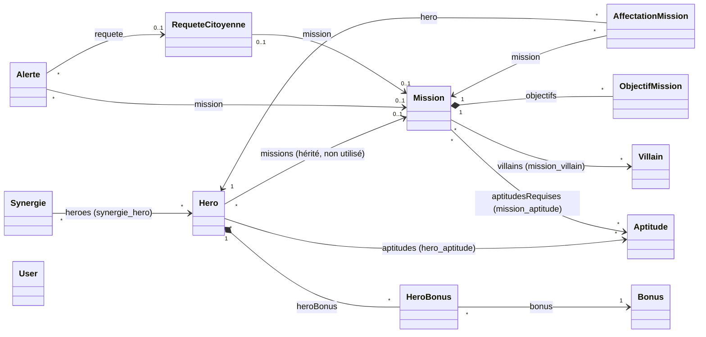

# Modèle de domaine

Ce document décrit les 12 entités Doctrine de `src/Entity/`, le trait `TimestampableTrait` et les
14 enums de `src/Enum/`. Toutes les entités ont un identifiant `id` de type `int`, auto-incrémenté.

## Sommaire

1. [Diagramme des relations](#diagramme-des-relations)
2. [Hero](#hero)
3. [Mission](#mission)
4. [ObjectifMission](#objectifmission)
5. [AffectationMission](#affectationmission)
6. [RequeteCitoyenne](#requetecitoyenne)
7. [Alerte](#alerte)
8. [Villain](#villain)
9. [Aptitude](#aptitude)
10. [Bonus et HeroBonus](#bonus-et-herobonus)
11. [Synergie](#synergie)
12. [User](#user)
13. [TimestampableTrait](#timestampabletrait)
14. [Enums](#enums)
15. [Anomalie de mapping connue](#anomalie-de-mapping-connue)
16. [Fonctionnalités prévues](#fonctionnalités-prévues)

## Diagramme des relations



`User` n'a aucune relation. Les colonnes de jointure sont toutes côté propriétaire. Les
suppressions en cascade côté base (`onDelete`) sont indiquées pour chaque entité.

## Hero

**Rôle :** un super-héros du roster, avec ses statistiques, sa santé, sa position et sa progression.
L'entité est marquée `HasLifecycleCallbacks` et utilise `TimestampableTrait`.

### Attributs

| Attribut | Type PHP | Type Doctrine | Défaut | Validation |
|---|---|---|---|---|
| `nom` | `?string` | `string(255)` | — | `NotBlank`, `Length(max 255)` via `HeroType` |
| `rang` | `?string` | `string(255)` | — | `NotBlank` via le formulaire, qui propose `ALPHA`, `BETA`, `OMEGA` |
| `pointsDeVie` | `?int` | `integer` | — | Callback : obligatoire, ≥ 0, ≤ `pointsDeVieMaximum` |
| `statCombat`, `statIntelligence`, `statCharisme`, `statMobilite`, `statVigueur` | `?string` | `decimal(5,2)` | — | `Range(0,100)` sur les getters entiers (`getCombat()`…) |
| `positionX`, `positionY` | `?float` | `float` | — | `Range(0,100)` via `HeroType` |
| `niveau` | `?int` | `integer` | — | Callback : ≥ 1 |
| `xp` | `?int` | `integer` | — | Callback : ≥ 0 (XP accumulée dans le niveau courant) |
| `description` | `?string` | `text`, nullable | `null` | — |
| `alias` | `?string` | `string(255)`, nullable | `null` | — (identité civile) |
| `specialite` | `?string` | `string(255)`, nullable | `null` | — |
| `role` | `HeroRole` | `string(20)`, enum | `ASSAUT` | — |
| `statut` | `HeroStatut` | `string(20)`, enum | `DISPONIBLE` | — |
| `pointsDeVieMaximum` | `int` | `integer` | `100` | `Positive` |
| `fatigue` | `int` | `integer` | `0` | `Range(0,100)`, bornée par le setter |
| `secteur` | `?string` | `string(255)`, nullable | `null` | — |
| `image` | `?string` | `string(255)`, nullable | `null` | — (chemin ou URL) |

### Relations

| Attribut | Type | Cible | Détails |
|---|---|---|---|
| `aptitudes` | ManyToMany | `Aptitude` | Table `hero_aptitude` |
| `heroBonus` | OneToMany | `HeroBonus` | `cascade: persist`, `orphanRemoval` |
| `affectations` | OneToMany | `AffectationMission` | Triées par `dateAffectation DESC` |
| `synergies` | ManyToMany (inverse) | `Synergie` | `mappedBy: heroes` |
| `missions` | ManyToOne | `Mission` | Relation d'origine, **non utilisée** (voir [anomalie](#anomalie-de-mapping-connue)) ; accesseurs `getManyToOne()` / `setManyToOne()` |

### Méthodes métier

- `getCombat()`…`getVigueur()` / `setCombat()`… : statistiques exposées en entiers de 0 à 100 et
  stockées dans les colonnes `DECIMAL`.
- `getStat(Statistique)`, `setStat()`, `getStats()` : accès générique. `GLOBAL` renvoie la moyenne
  des cinq statistiques et ne peut pas être modifiée.
- `getSantePourcentage()` : `pointsDeVie / pointsDeVieMaximum`, en pourcentage de 0 à 100.
- `isDisponible()` : vrai si `statut === DISPONIBLE`.
- `getBonusEnVigueur(DateTimeImmutable)` : renvoie les `HeroBonus` en vigueur à cet instant.
- `getAffectationActive()` : première affectation active liée à une mission active.
- `getInitiales()` : deux premières lettres du nom, en majuscules.
- Constantes `STAT_MIN = 0` et `STAT_MAX = 100`.

## Mission

**Rôle :** une intervention, avec sa difficulté, son urgence, son échéance, ses exigences, ses
objectifs et l'équipe affectée. L'entité utilise `TimestampableTrait`.

### Attributs

| Attribut | Type PHP | Type Doctrine | Défaut | Validation |
|---|---|---|---|---|
| `nom` | `?string` | `string(255)` | — | `NotBlank`, `Length(max 255)` via `MissionType` (fait office de titre) |
| `description` | `?string` | `text` | — | `NotBlank` via le formulaire |
| `niveauDeDifficulte` | `?string` | `string(255)` | — | Callback : doit être une valeur de `Difficulte` (accesseurs `getDifficulte()` / `setDifficulte()`) |
| `tauxDeReussite` | `?int` | `integer` | — | Callback : de 0 à 100 |
| `timer` | `?DateTimeImmutable` | `datetime_immutable` | — | Échéance prévue (accesseurs `getDateFinPrevue()` / `setDateFinPrevue()`) ; `NotNull` via le formulaire ; callback : postérieure à `dateDebut` |
| `combatRequis`, `intelligenceRequis`, `mobiliteRequis`, `vigueurRequis` | `?int` | `integer`, nullable | `null` | Callback : de 0 à 100 |
| `charismeRequis` | `?int` | `integer`, nullable | `null` | Idem. Le setter n'accepte pas `null` (code d'origine) ; les services y écrivent `0` |
| `localisation` | `?string` | `string(255)`, nullable | `null` | — |
| `positionX`, `positionY` | `float` | `float` | `50.0` | `Range(0,100)` |
| `statut` | `MissionStatut` | `string(20)`, enum | `BROUILLON` | — |
| `niveauUrgence` | `NiveauUrgence` | `string(20)`, enum | `MOYENNE` | — |
| `tailleEquipeMinimale` | `int` | `integer` | `1` | `Range(1,12)` |
| `tailleEquipeMaximale` | `int` | `integer` | `4` | `Range(1,12)` ; callback : ≥ minimale |
| `seuilSanteMinimal` | `int` | `integer` | `30` | `Range(0,100)`, santé minimale exigée pour déployer un héros (en %) |
| `cible`, `etatCible` | `?string` | `string(255)`, nullable | `null` | — |
| `dateDebut`, `dateFinReelle` | `?DateTimeImmutable` | `datetime_immutable`, nullable | `null` | — |

### Relations

| Attribut | Type | Cible | Détails |
|---|---|---|---|
| `objectifs` | OneToMany | `ObjectifMission` | `cascade: persist`, `orphanRemoval`, triés par `ordreAffichage ASC` |
| `affectations` | OneToMany | `AffectationMission` | `cascade: persist` |
| `villains` | ManyToMany | `Villain` | Table `mission_villain` |
| `aptitudesRequises` | ManyToMany | `Aptitude` | Table `mission_aptitude` |
| `heroes` | OneToMany | `Hero` | **Mapping invalide**, non utilisé |

Le constructeur d'origine n'initialise que `heroes`. Les autres collections sont créées à la
demande dans leurs getters (`??= new ArrayCollection()`).

### Méthodes métier

- `getStatRequise(Statistique)` et `getStatsRequises()` : exigences non nulles et strictement positives.
- `getAffectationsActives()` et `getHerosAffectes()` : équipe en cours (affectations `AFFECTE` ou `SUR_PLACE`).
- `getProgression()` : moyenne de la progression des objectifs, 0 s'il n'y en a aucun.
- `getNiveauMenaceMax()` : menace la plus élevée parmi les vilains associés.
- `isCritique()` : vrai si l'urgence est `CRITIQUE` ou la difficulté `S`.

## ObjectifMission

**Rôle :** une étape d'une mission, qui porte sa propre progression.

| Attribut | Type PHP | Type Doctrine | Défaut | Validation |
|---|---|---|---|---|
| `titre` | `?string` | `string(255)` | — | `NotBlank`, `Length(max 255)` |
| `description` | `?string` | `text`, nullable | `null` | — |
| `progression` | `int` | `integer` | `0` | `Range(0,100)`, bornée par le setter |
| `ordreAffichage` | `int` | `integer` | `0` | `PositiveOrZero` |
| `obligatoire` | `bool` | `boolean` | `true` | — |
| `termine` | `bool` | `boolean` | `false` | — |
| `mission` | `?Mission` | ManyToOne, non nullable | — | `onDelete: CASCADE` |

Les deux champs sont synchronisés : `setProgression(100)` passe `termine` à vrai, et
`setTermine(true)` fixe la progression à 100. `getEtat()` renvoie `termine`, `en_cours` ou `en_attente`.

## AffectationMission

**Rôle :** le lien historisé entre un héros et une mission. Il remplace la relation directe d'origine.

| Attribut | Type PHP | Type Doctrine | Défaut | Validation |
|---|---|---|---|---|
| `hero` | `?Hero` | ManyToOne, non nullable | — | `onDelete: CASCADE` |
| `mission` | `?Mission` | ManyToOne, non nullable | — | `onDelete: CASCADE` |
| `role` | `RoleEquipe` | `string(20)`, enum | `MEMBRE` | — |
| `dateAffectation` | `?DateTimeImmutable` | `datetime_immutable` | maintenant (constructeur) | — |
| `dateArrivee` | `?DateTimeImmutable` | nullable | `null` | — |
| `statut` | `AffectationStatut` | `string(20)`, enum | `AFFECTE` | Index `idx_affectation_statut` |
| `pointsDeVieAuDepart` | `int` | `integer` | PV du héros à la création | `PositiveOrZero` |
| `contribution` | `?int` | `integer`, nullable | `null` | `Range(0,100)`, renseignée à la clôture |

`isActive()` délègue à `AffectationStatut::isActive()`, qui est vrai pour `AFFECTE` et `SUR_PLACE`.

## RequeteCitoyenne

**Rôle :** un signalement reçu d'un citoyen ou d'un service, qui peut être converti en mission.

| Attribut | Type PHP | Type Doctrine | Défaut | Validation |
|---|---|---|---|---|
| `titre` | `?string` | `string(255)` | — | `NotBlank`, `Length(max 255)` |
| `description` | `?string` | `text` | — | `NotBlank` |
| `adresse` | `?string` | `string(255)` | — | `NotBlank` |
| `positionX`, `positionY` | `float` | `float` | `50.0` | `Range(0,100)` |
| `niveauUrgence` | `NiveauUrgence` | `string(20)`, enum | `MOYENNE` | — |
| `statut` | `RequeteStatut` | `string(20)`, enum | `NOUVELLE` | — |
| `categorie` | `RequeteCategorie` | `string(30)`, enum | `ASSISTANCE_PUBLIQUE` | — |
| `origine` | `OrigineAlerte` | `string(20)`, enum | `CIVIL` | — |
| `nomDemandeur` | `?string` | `string(255)` | — | `NotBlank` |
| `dateCreation` | `?DateTimeImmutable` | `datetime_immutable` | maintenant | — |
| `mission` | `?Mission` | OneToOne, nullable, unique | `null` | `onDelete: SET NULL` |

`getReference()` renvoie `REQ-0042` (identifiant sur 4 chiffres).

## Alerte

**Rôle :** une alerte persistée, générée par `AlerteService` ou par les fixtures et affichée dans
le bandeau et la barre supérieure.

| Attribut | Type PHP | Type Doctrine | Défaut |
|---|---|---|---|
| `titre` | `string` | `string(255)` | constructeur |
| `message` | `string` | `text` | constructeur |
| `niveau` | `NiveauAlerte` | `string(20)`, enum | constructeur |
| `code` | `string` | `string(40)` | constructeur, de la forme `REQ-HHMMSS-XXXX` ou `MIS-…` |
| `createdAt` | `DateTimeImmutable` | `datetime_immutable` | maintenant |
| `acquittee` | `bool` | `boolean` | `false` ; index `idx_alerte_active (acquittee, created_at)` |
| `mission` | `?Mission` | ManyToOne, nullable | `onDelete: SET NULL` |
| `requete` | `?RequeteCitoyenne` | ManyToOne, nullable | `onDelete: SET NULL` |

Il n'y a aucune contrainte de validation : l'entité n'est jamais alimentée par un formulaire.
`acquitter()` passe `acquittee` à vrai.

## Villain

**Rôle :** un adversaire associé à une ou plusieurs missions. Sa menace pèse sur le taux de réussite.

| Attribut | Type PHP | Type Doctrine | Défaut | Validation |
|---|---|---|---|---|
| `nom` | `?string` | `string(255)` | — | `NotBlank` |
| `description` | `?string` | `text`, nullable | `null` | — |
| `niveauMenace` | `int` | `integer` | `1` | `Range(1,10)` |
| `combat`, `intelligence` | `int` | `integer` | `0` | `Range(0,100)` |
| `image` | `?string` | `string(255)`, nullable | `null` | — |
| `statut` | `VillainStatut` | `string(20)`, enum | `EN_LIBERTE` | — |
| `missions` | Collection | ManyToMany (inverse) | — | `mappedBy: villains` |

## Aptitude

**Rôle :** une capacité ou une immunité (vol, immunité énergétique…). Un héros peut la posséder et
une mission peut l'exiger.

| Attribut | Type PHP | Type Doctrine | Validation |
|---|---|---|---|
| `code` | `?string` | `string(50)`, unique | `NotBlank`, `Regex /^[A-Z0-9_]+$/`, `UniqueEntity` |
| `nom` | `?string` | `string(120)` | `NotBlank` |
| `description` | `?string` | `text`, nullable | — |

## Bonus et HeroBonus

**`Bonus`** est la définition générale d'un bonus :

| Attribut | Type PHP | Type Doctrine | Défaut | Validation |
|---|---|---|---|---|
| `code` | `?string` | `string(50)`, unique | — | `NotBlank`, `UniqueEntity` |
| `nom` | `?string` | `string(120)` | — | `NotBlank` |
| `description` | `?string` | `text`, nullable | `null` | — |
| `statistique` | `Statistique` | `string(20)`, enum | `GLOBAL` | — |
| `valeurParDefaut` | `int` | `integer` | `5` | `Range(-50,50)` |

**`HeroBonus`** représente l'attribution d'un bonus à un héros :

| Attribut | Type PHP | Type Doctrine | Défaut | Validation |
|---|---|---|---|---|
| `hero` | `?Hero` | ManyToOne, non nullable | — | `onDelete: CASCADE` |
| `bonus` | `?Bonus` | ManyToOne, non nullable | — | `onDelete: CASCADE` |
| `valeur` | `int` | `integer` | `valeurParDefaut` du bonus | `Range(-50,50)` |
| `dateDebut` | `?DateTimeImmutable` | `datetime_immutable` | maintenant | — |
| `dateExpiration` | `?DateTimeImmutable` | nullable | `null` | `GreaterThan(dateDebut)` |
| `origine` | `BonusOrigine` | `string(20)`, enum | `EQUIPEMENT` | — |
| `cumulable` | `bool` | `boolean` | `true` | — |
| `actif` | `bool` | `boolean` | `true` | — |

`isEnVigueur($now)` est vrai si le bonus est actif, déjà commencé et pas encore expiré. Les règles
de cumul sont appliquées par `EffectiveStatsResolver` : les bonus cumulables s'additionnent, et
parmi les non cumulables, seul le plus élevé par statistique s'applique.

## Synergie

**Rôle :** un bonus collectif, accordé quand plusieurs héros liés font partie de la même équipe.

| Attribut | Type PHP | Type Doctrine | Défaut | Validation |
|---|---|---|---|---|
| `nom` | `?string` | `string(120)` | — | `NotBlank` |
| `description` | `?string` | `text`, nullable | `null` | — |
| `heroes` | Collection | ManyToMany → `Hero` (`synergie_hero`) | — | `Count(min 2)` |
| `statistique` | `Statistique` | `string(20)`, enum | `GLOBAL` | — |
| `valeurBonus` | `int` | `integer` | `5` | `Range(1,50)` |
| `nombreMinimalHeros` | `?int` | `integer`, nullable | `null` (tous les héros liés) | `Positive` |
| `difficulteMinimale` | `?Difficulte` | `string(1)`, enum, nullable | `null` | — |
| `actif` | `bool` | `boolean` | `true` | — |

Une synergie est active si elle est marquée active, si au moins `max(2, nombreMinimalHeros ?? tous)`
de ses héros sont dans l'équipe, et si la mission atteint `difficulteMinimale`. C'est
`SynergyResolver` qui l'évalue.

## User

**Rôle :** un compte opérateur ou administrateur. La classe implémente `UserInterface` et
`PasswordAuthenticatedUserInterface`. La table s'appelle `` `user` `` (nom échappé).

| Attribut | Type PHP | Type Doctrine | Validation |
|---|---|---|---|
| `email` | `?string` | `string(180)`, unique | `NotBlank`, `Email`, `UniqueEntity` |
| `nom` | `?string` | `string(120)` | `NotBlank` |
| `fonction` | `?string` | `string(120)`, nullable | — |
| `roles` | `array` | `json` | — ; `getRoles()` ajoute toujours `ROLE_USER` |
| `password` | `?string` | `string` | Hachage, jamais en clair |

La constante `User::ROLES` vaut `['Opérateur' => 'ROLE_OPERATOR', 'Administrateur' => 'ROLE_ADMIN']`.
`__serialize()` remplace le hachage par son CRC32C dans la session.

## TimestampableTrait

Utilisé par `Hero` et `Mission`, il ajoute `createdAt` et `updatedAt` (`datetime_immutable`).
Ces champs sont renseignés par `#[PrePersist]` (`initialiserHorodatage()`) et `#[PreUpdate]`
(`rafraichirHorodatage()`).

## Enums

Toutes les enums sont adossées à des chaînes (`string`), et leur valeur est égale à leur nom.

| Enum | Cas | Méthodes |
|---|---|---|
| `HeroRole` | `ASSAUT`, `CONTROLE`, `SOUTIEN`, `ECLAIREUR` | `label()` |
| `HeroStatut` | `DISPONIBLE`, `EN_MISSION`, `BLESSE`, `INDISPONIBLE`, `REPOS` | `label()`, `tone()` |
| `MissionStatut` | `BROUILLON`, `EN_ATTENTE`, `EN_COURS`, `TERMINEE`, `ECHOUEE`, `ANNULEE` | `label()`, `isActive()` (en attente ou en cours), `isClosed()`, `actifs()` |
| `Difficulte` | `D`, `C`, `B`, `A`, `S` | `niveauRecommande()` (10 à 50), `multiplicateur()` (1,10 à 0,85), `experienceRecompense()` (200 à 3000), `rang()`, `label()` |
| `NiveauUrgence` | `FAIBLE`, `MOYENNE`, `HAUTE`, `CRITIQUE` | `label()`, `poids()` (1 à 4), `isUrgent()` (poids ≥ 3), `tone()` |
| `RequeteStatut` | `NOUVELLE`, `EN_QUALIFICATION`, `CONVERTIE`, `CLASSEE` | `label()`, `isOuverte()` |
| `RequeteCategorie` | `URGENCE_VITALE`, `SUPER_VILAIN`, `CATASTROPHE`, `ASSISTANCE_PUBLIQUE` | `label()` |
| `OrigineAlerte` | `CIVIL`, `POLICE`, `POMPIERS`, `CAPTEUR` | `label()` |
| `NiveauAlerte` | `INFO`, `ALERTE`, `CRITIQUE` | `tone()` |
| `AffectationStatut` | `AFFECTE`, `SUR_PLACE`, `TERMINEE`, `RETIRE` | `label()`, `isActive()` |
| `RoleEquipe` | `LEAD`, `MEMBRE`, `RESERVISTE` | `label()` |
| `Statistique` | `COMBAT`, `INTELLIGENCE`, `CHARISME`, `MOBILITE`, `VIGUEUR`, `GLOBAL` | `label()`, `heroStats()` (sans `GLOBAL`) |
| `BonusOrigine` | `EQUIPEMENT`, `MEDICAL`, `ENTRAINEMENT`, `MISSION`, `EVENEMENT` | `label()` |
| `VillainStatut` | `EN_LIBERTE`, `LOCALISE`, `CAPTURE`, `NEUTRALISE` | `label()` |

## Anomalie de mapping connue

`Mission::$heroes` déclare `#[ORM\OneToMany(targetEntity: Hero::class, mappedBy: 'ManyToOne')]`.
Or le champ propriétaire côté `Hero` s'appelle `missions`, pas `ManyToOne`.
`php bin/console doctrine:schema:validate` produit :

```
[FAIL] The entity-class App\Entity\Mission mapping is invalid:
 * The association App\Entity\Mission#heroes refers to the owning side field App\Entity\Hero#ManyToOne which does not exist.
```

- Ce code est **d'origine** : il est antérieur aux ajouts et a été volontairement laissé tel quel.
- La migration crée bien la colonne `hero.missions_id` (clé étrangère vers `mission`), mais l'application ne l'utilise pas.
- **Toute affectation passe par `AffectationMission`.** N'utilisez ni `Mission::getHeroes()` ni
  `Hero::getManyToOne()`.
- Correctif possible, non appliqué : `mappedBy: 'missions'`, ou supprimer la relation, puis générer une migration.

## Fonctionnalités prévues

Ces éléments apparaissent dans les maquettes ou le besoin métier, mais **n'ont pas de
représentation dans le modèle** :

- télémétrie biométrique (pouls, charge kinétique, blindage) ;
- arbre de talents et points de compétence ;
- habilitation de risque d'un héros (exemple « OMEGA ») distincte du rang ;
- source détaillée d'une requête (nombre de signalements, images de drone) ;
- coordonnées GPS réelles : les positions sont des coordonnées abstraites de 0 à 100 km.
  `TacticalGrid` prévoit une projection future vers lat/lng, non implémentée.
