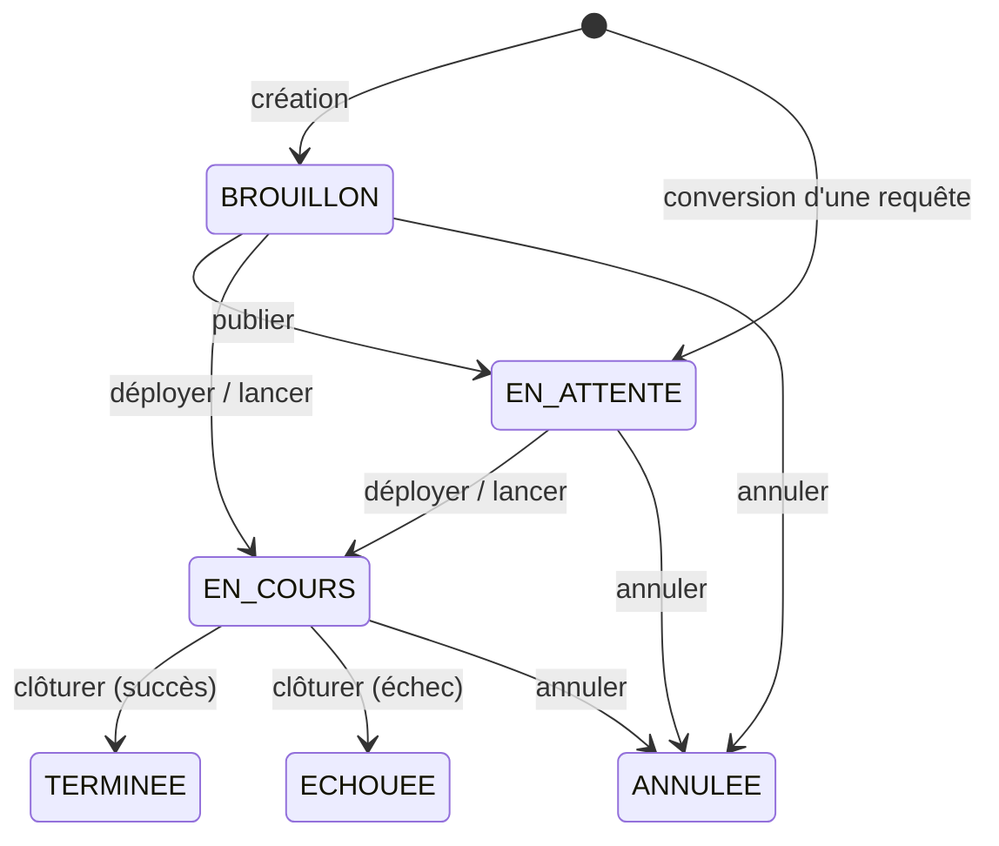

# Fonctionnalités

L'état de chaque fonctionnalité a été établi **en lisant le code** (contrôleurs, services,
templates), pas les maquettes.

| Légende | Signification |
|---|---|
| ✅ Implémentée | Utilisable dans l'interface et couverte par la logique serveur |
| 🟡 Partielle | Existe, mais incomplète ou sans interface de gestion |
| 🔵 Prévue | Annoncée par une maquette ou un commentaire de code, sans implémentation |
| ⛔ Absente | Ni code ni interface |

## Synthèse

| Fonctionnalité | État |
|---|---|
| [Centre tactique](#centre-tactique) | ✅ |
| [Gestion des missions](#gestion-des-missions) | ✅ (pas de suppression) |
| [Objectifs de mission](#objectifs-de-mission) | ✅ |
| [Timers](#timers) | ✅ |
| [Taux de réussite](#taux-de-réussite) | ✅ |
| [Carte tactique](#carte-tactique) | 🟡 (carte SVG abstraite) |
| [Requêtes citoyennes](#requêtes-citoyennes) | ✅ |
| [Conversion requête → mission](#conversion-dune-requête-en-mission) | ✅ |
| [Roster des héros](#roster-des-héros) | ✅ |
| [Statistiques et graphiques](#statistiques-et-graphiques) | ✅ |
| [Santé des héros](#santé-des-héros) | 🟡 (aucune récupération) |
| [Progression](#progression) | 🟡 (XP à la clôture uniquement) |
| [Bonus](#bonus) | 🟡 (aucune interface de gestion) |
| [Vilains](#vilains) | ✅ (pas de suppression) |
| [Squad Builder](#squad-builder) | ✅ |
| [Constitution et déploiement](#constitution-et-déploiement-dune-équipe) | ✅ |
| [Suggestions de héros](#suggestions-de-héros) | ✅ |
| [Synergies](#synergies) | 🟡 (aucune interface de gestion) |
| [Alertes](#alertes) | ✅ |
| [Administration des utilisateurs](#administration-des-utilisateurs) | ✅ (pas de suppression) |

## Centre tactique

**✅ Implémentée.** Route `app_tactical_center` (`/`), contrôleur `TacticalCenterController`.

- Liste « Missions en direct » : missions actives par défaut (`EN_ATTENTE` et `EN_COURS`), avec un
  filtre par statut (puces) et des filtres par difficulté et urgence.
- Sélection d'une mission (`?mission=ID`). À défaut, la première mission en cours est sélectionnée.
- Panneau HUD de la mission sélectionnée (`tactical_center/_hud.html.twig`) : timer, objectifs, accès au Squad Builder.
- « Statut global de protection » : moyenne des taux de réussite des missions actives qui ont une équipe engagée.
- Compteurs : héros déployés (`EN_MISSION`) et en réserve (`DISPONIBLE`).
- Bandeau de la dernière alerte non acquittée, avec le bouton « Scramble Unités » (lien vers le Squad Builder) ou « Traiter ».
- Bandeau de l'escouade engagée sur la mission sélectionnée.

## Gestion des missions

**✅ Implémentée**, avec une exception : **la suppression est absente**.

| Action | Route | Rôle |
|---|---|---|
| Liste paginée (10 par page), filtre par statut | `app_mission_index` | `ROLE_OPERATOR` |
| Fiche | `app_mission_show` | `ROLE_OPERATOR` |
| Création (statut `BROUILLON`) | `app_mission_new` | `ROLE_ADMIN` |
| Modification (recalcule le taux si une équipe est affectée) | `app_mission_edit` | `ROLE_ADMIN` |
| Transitions `publier`, `lancer`, `cloturer`, `annuler` | `app_mission_transition` | `ROLE_ADMIN` |

Cycle de vie (`MissionLifecycleService`) :

- **Clôture** : les affectations passent à `TERMINEE`, chaque héros gagne de l'XP (récompense de la
  difficulté, ×0,3 en cas d'échec) et +15 de fatigue. Les héros sont ensuite libérés : `BLESSE` si
  leur santé est inférieure à 30 %, `DISPONIBLE` sinon.
- **Annulation** : les affectations actives passent à `RETIRE` et les héros sont libérés.
- **Création d'une mission critique** (urgence `CRITIQUE` ou rang `S`) : une alerte est générée automatiquement.
- 🟡 **« Lancer »** exige une équipe déjà affectée. Or le déploiement depuis le Squad Builder fait
  déjà passer la mission en `EN_COURS`. Depuis l'interface, l'action « Lancer » n'aboutit donc
  qu'en échec (« Constituez d'abord une équipe… »).

## Objectifs de mission

**✅ Implémentée.**

- Ajout (`app_mission_objectif_add`, admin) : titre, détail, progression, ordre, obligatoire, terminé.
- Mise à jour de la progression par curseur (`app_mission_objectif_progress`), **ouverte aux
  opérateurs**, tant que la mission n'est pas close.
- Suppression (`app_mission_objectif_delete`, admin).
- Progression globale de la mission : moyenne des objectifs.
- Affichage en trois états : terminé (barré), en cours (jauge), en attente.

Le champ `obligatoire` est affiché, mais aucune règle métier ne l'utilise : par exemple, rien
n'empêche de clôturer une mission dont un objectif obligatoire n'est pas terminé.

## Timers

**✅ Implémentée.** Service `MissionTimer`, partiel `components/_timer.html.twig`, contrôleur Stimulus `countdown`.

- Temps restant = `max(0, dateFinPrevue − maintenant)`. Il n'est jamais négatif ; à zéro, le
  libellé devient « Mission terminée ».
- Le serveur calcule la valeur initiale. Le navigateur décrémente ensuite à partir de
  `performance.now()`, ce qui le rend insensible à l'horloge du poste, puis se resynchronise
  toutes les 60 s via `GET /api/missions/{id}/timer`.
- Format `HH:MM:SS`, avec un nombre d'heures qui peut dépasser 24.
- L'échéance est **informative** : son dépassement ne change pas le statut de la mission.

## Taux de réussite

**✅ Implémentée.** Service `MissionSuccessCalculator`, qui renvoie un `SuccessPrognosis`.

Le calcul combine, avec des poids, les statistiques effectives de l'équipe face aux exigences
(45 %), le niveau (15 %), la santé (20 %) et la proximité (20 %). Le résultat est ensuite ajusté
par le multiplicateur de difficulté, la menace des vilains, les bonus `GLOBAL`, les synergies,
les aptitudes manquantes (−10 chacune) et la taille de l'équipe. La formule complète est dans le
docblock de la classe.

Le taux est recalculé à chaque modification de la composition dans le Squad Builder, puis stocké
dans `Mission::tauxDeReussite` au déploiement, au lancement ou à la modification d'une mission
dont l'équipe est affectée.

## Carte tactique

**🟡 Partielle.** La carte est un **SVG abstrait** (`components/_tactical_map.html.twig`) alimenté
par `TacticalMapProvider`.

- Implémenté :
  - grille de 100 × 100 km et QG en (50, 50) ;
  - marqueurs de missions actives (liens de sélection) et de héros (liens vers leur fiche) ;
  - zones de menace dont le rayon et la couleur dépendent de la menace ;
  - calques « Zones de menace » et « Héros » activables ;
  - HUD masquable.
- **Absent** : les calques « Satellite » et « Thermique », le rafraîchissement, les données
  météo et « bouclier », et la vraie cartographie (Leaflet/OSM, mentionnés comme évolution
  possible dans `TacticalGrid`).

## Requêtes citoyennes

**✅ Implémentée.** Route `app_requete_index` (`/requetes`).

- Formulaire « Saisie opérateur » : origine, faits, détails, catégorie, adresse, position X/Y,
  urgence et demandeur.
- Indicateurs : requêtes reçues sur 24 h, urgences non traitées, requêtes converties, catégorie dominante.
- Filtres par catégorie et « urgentes seulement », tri par urgence ou par date.
- « Classer sans suite » (`app_requete_close`) est **ouvert aux opérateurs**.
- Une requête `HAUTE` ou `CRITIQUE` génère une alerte à l'enregistrement.
- **Absent** : la carte interactive de localisation (la position se saisit en X/Y), les actions
  « Transmettre brigade », « Dépêcher secours », « Synchroniser flux » de la maquette, et les
  indicateurs « temps moyen de réponse » et « taux d'intervention ».
- Le statut `EN_QUALIFICATION` existe, mais aucune action de l'interface n'y conduit.

## Conversion d'une requête en mission

**✅ Implémentée.** Route `app_requete_convert`, `ROLE_ADMIN` uniquement.

`RequeteCitoyenneService::convertirEnMission()` :

- crée une mission en statut `EN_ATTENTE`, avec le titre, la description, l'adresse, la position
  et l'urgence de la requête ;
- déduit la difficulté de l'urgence (`FAIBLE`→D, `MOYENNE`→C, `HAUTE`→B, `CRITIQUE`→A) ;
- fixe l'échéance selon l'urgence (24 h, 6 h, 2 h ou 45 min) ;
- fixe la taille d'équipe à 2–5 si l'urgence est critique, 1–4 sinon ;
- passe la requête au statut `CONVERTIE` et conserve le lien (OneToOne) ;
- crée une alerte si la mission est critique.

Une requête ne peut être convertie qu'une fois. L'utilisateur est ensuite redirigé vers la fiche
de la mission.

## Roster des héros

**✅ Implémentée.** Route `app_hero_index` / `app_hero_show` (`/heros`).

- Liste paginée (5 par page) avec recherche sur le nom, l'alias et la spécialité (également
  accessible depuis la barre de recherche globale), un filtre par rôle et un tri par niveau, nom ou PV.
- Compteurs par rôle et par statut.
- Fiche : identité, rang, niveau, statut, secteur, coordonnées, dernier déploiement, jauge d'XP,
  santé, fatigue, bonus actifs, aptitudes, radar et barres de statistiques, historique des
  missions avec le taux de succès, synergies connues.
- Création, modification et suppression : `ROLE_ADMIN`. La suppression est refusée si le héros est engagé en mission.
- **Absent** : l'export du roster, l'arbre de talents, la télémétrie biométrique (pouls, charge,
  blindage), « Ordonner repos », « Rapport de performance » et « Mettre à niveau l'équipement ».

## Statistiques et graphiques

**✅ Implémentée.**

- Cinq statistiques de 0 à 100 : combat, intelligence, charisme, mobilité, vigueur. `GLOBAL` est calculée.
- Radar Chart.js (contrôleur `radar_chart`) des **statistiques effectives**, bonus compris.
- Barres textuelles accessibles, qui affichent l'écart dû aux bonus.
- Jauges de pronostic par statistique dans le Squad Builder.
- **Absent** : graphiques temporels et tableaux de bord statistiques globaux.

## Santé des héros

**🟡 Partielle.**

- Implémenté :
  - PV, PV max et pourcentage de santé ;
  - fatigue de 0 à 100 ;
  - seuil de santé par mission, **bloquant** au déploiement ;
  - avertissement non bloquant si la fatigue atteint 70 ou plus ;
  - passage à `BLESSE` en dessous de 30 % lors de la libération.
- **Absent** : aucune récupération automatique des PV ou de la fatigue, et aucune action de repos
  ou de soin. Seul un administrateur peut modifier ces valeurs, via le formulaire du héros.

## Progression

**🟡 Partielle.** Service `HeroProgressionService`.

- Règles : seuil de `375 × niveau` XP, montée de plusieurs niveaux possible, +2 sur chaque
  statistique (plafonnées à 100) et +5 PV max par niveau, niveau max 100.
- L'XP n'est attribuée **qu'à la clôture d'une mission**. Il n'y a ni interface d'attribution
  manuelle, ni historique de progression.

## Bonus

**🟡 Partielle.**

- Implémenté :
  - modèle `Bonus` / `HeroBonus` : période de validité, origine, cumul ;
  - application dans les statistiques effectives, le taux de réussite et les recommandations ;
  - affichage des bonus en vigueur sur la fiche héros.
- **Absent** : il n'existe aucun écran ni aucune route pour créer ou attribuer un bonus. Les bonus
  ne proviennent que des fixtures.

## Vilains

**✅ Implémentée** (administration), avec une exception : **la suppression est absente**.

- Liste triée par menace, création et modification (`/admin/vilains`, `ROLE_ADMIN`).
- Association aux missions via le formulaire de mission.
- Effet sur le taux de réussite (menace, combat, intelligence) et sur le rayon des zones de la carte.
- Le statut du vilain (`EN_LIBERTE`, `CAPTURE`…) n'est pas mis à jour par la clôture d'une mission.

## Squad Builder

**✅ Implémentée.** Routes `app_squad_builder*` (`/squad-builder`), service `SquadBuilder`.

- Choix de la mission : `BROUILLON` ou `EN_ATTENTE`. Sans paramètre, la première mission candidate est ouverte.
- Emplacements réglables entre la taille minimale et la taille maximale de la mission.
- La composition est portée par l'URL (`?equipe=3,7,12`) : ajouter, retirer ou remplacer un héros
  (« Changer »), ou « Réinitialiser ».
- Réserve filtrable :
  - `tous`, `disponibles` (éligibles) ;
  - `base` : héros à 1,5 km ou moins du QG ;
  - `proximite` : héros à moins de 5 km de la mission ;
  - par rôle, niveau minimal et santé minimale.
- Pronostic détaillé : taux, puissance par statistique, synergies actives, aptitudes manquantes.
- Rapport de validation : erreurs bloquantes et avertissements.
- **Absent** : « Simuler scénarios de combat », l'affectation en tant que réserviste (le rôle
  `RESERVISTE` existe mais n'est jamais attribué) et le choix explicite du chef d'escouade.

## Constitution et déploiement d'une équipe

**✅ Implémentée.** Route `app_squad_builder_deploy` (POST), service `MissionDeploymentService`, ouvert aux opérateurs.

- Règles **bloquantes** (`DeploymentValidator`) :
  - mission close ou déjà en cours ;
  - taille de l'équipe hors limites ;
  - doublon ;
  - héros indisponible ou engagé sur une autre mission active ;
  - santé sous le seuil ;
  - aptitude obligatoire non couverte ;
  - exigence de statistique non atteinte par au moins un membre.
- **Avertissements** : fatigue de 70 ou plus, distance supérieure à 20 km.
- Le déploiement se fait dans une transaction, avec verrou d'écriture sur la mission et les
  héros. Deux déploiements concurrents du même héros sont sérialisés et le second est refusé.
- Résultat :
  - une `AffectationMission` (`AFFECTE`) par héros ; le **premier héros de la composition** devient `LEAD` ;
  - les héros passent à `EN_MISSION` ;
  - la mission passe à `EN_COURS` (taux et `dateDebut` renseignés) ;
  - l'utilisateur est redirigé vers le centre tactique.
- Le statut d'affectation `SUR_PLACE` et `dateArrivee` existent, mais aucune action de l'interface
  ne les renseigne (seules les fixtures le font).

## Suggestions de héros

**✅ Implémentée.** Service `HeroRecommendationService`.

- Score d'affinité de 0 à 100, calculé à partir de la santé, de la proximité, de la couverture des
  exigences, du niveau, du rôle manquant, des aptitudes uniques apportées, du gain de synergie,
  des bonus, de l'écart avec le vilain le plus fort et de la fatigue.
- Liste des raisons (« Apporte le rôle Soutien », « Synergie +8 »…) et motif d'inéligibilité.
- La réserve est triée par éligibilité puis par score. La suggestion du meilleur candidat
  éligible s'affiche dans l'emplacement vide.
- C'est une aide à la décision : le choix reste manuel.

## Synergies

**🟡 Partielle.**

- Implémenté : évaluation (`SynergyResolver`), effet sur le pronostic et les recommandations,
  qualité de synergie (« Aucune », « Neutre », « Correcte », « Bonne », « Optimale »), affichage
  sur la fiche héros.
- **Absent** : aucune interface de création ou de modification. Les synergies ne proviennent que des fixtures.

## Alertes

**✅ Implémentée.** Entité `Alerte`, service `AlerteService`.

- Génération automatique :
  - requête `HAUTE` (titre « Requête urgente ») ou `CRITIQUE` (« URGENCE ALPHA ») ;
  - mission critique créée ou convertie.
- Affichage : dernière alerte non acquittée dans la barre supérieure (toutes les pages) et en
  bandeau sur le centre tactique.
- Acquittement (`app_alerte_ack`, POST avec jeton CSRF).
- Simulation en développement : `php bin/console app:alertes:simuler --nombre=3`.
- **Absent** : temps réel (pas de Mercure ni de notification push : l'alerte apparaît au
  chargement de la page suivante), historique des alertes acquittées et notifications par e-mail
  ou SMS. Mailer et Notifier sont installés mais inutilisés.

## Administration des utilisateurs

**✅ Implémentée**, avec une exception : **la suppression est absente**.

- Liste, création (mot de passe obligatoire, 8 caractères minimum) et modification (mot de passe
  facultatif). Rôles proposés : `ROLE_OPERATOR`, `ROLE_ADMIN`.
- Aucun garde-fou n'empêche un administrateur de retirer son propre rôle `ROLE_ADMIN`.
